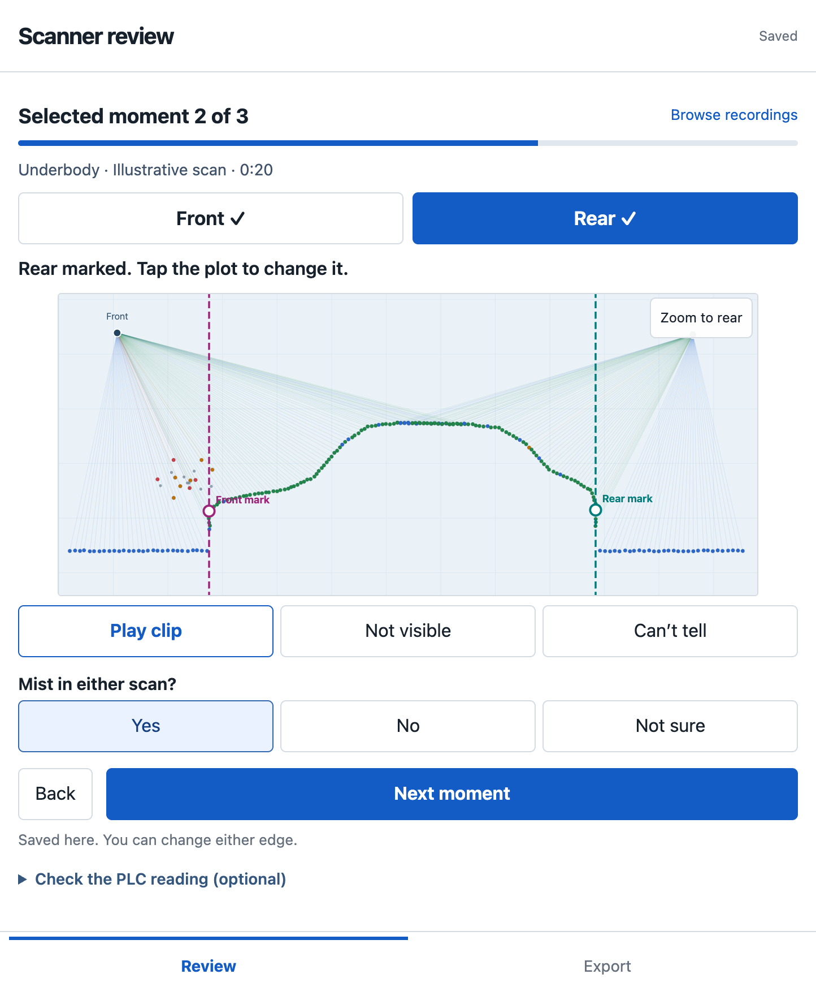
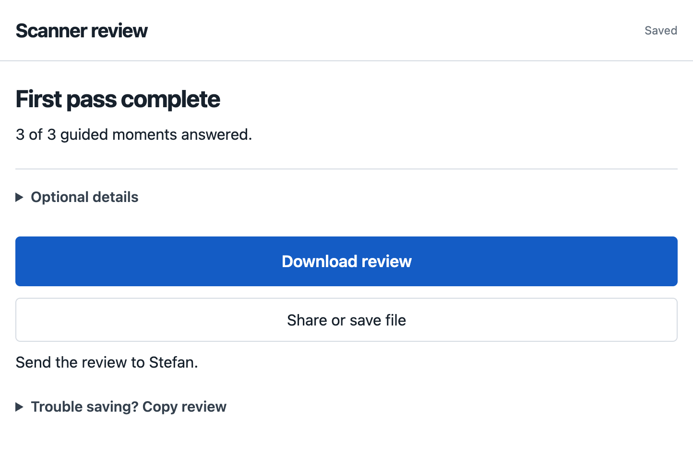

# LiDAR vehicle tracking in mist

Laser scanners at the entrance and exit of the wash bay track the front and rear of each vehicle. On cold days, the controller could mistake a reflection from mist for the front of the car and report that its position had jumped. The operator could still see the car’s outline in the replay. Tightening the filter sometimes made the controller lose the vehicle altogether.

I built a browser tool so the operator could mark the vehicle edges they could see, then tested two models against the controller on those same edges. The better model put 85 of 106 edges within tolerance, up from 83 for the controller. The gain came on clear scans.

## Scan data and labels

The recordings contained the laser returns and the position the controller had reported. I decoded 12 washes from four sites and built a guided review so the operator could mark where they saw the car. The tool queued 24 moments, one each from loading, the underbody wash and unloading in two washes per site. At the site reserved for evaluation, I chose the time within each phase before looking at the scans. The operator could also browse whole recordings and mark additional frames.

At each guided moment, the operator could play the surrounding scans and return to the exact frame. They tapped the furthest solid vehicle return toward the exit for the front edge and toward the entrance for the rear. If an edge was out of view or ambiguous, they could choose **Not visible** or **Can’t tell**. A separate answer recorded whether mist was visible. The controller’s position was hidden during those initial guided answers.



*Both screenshots show the original tool with three invented review moments. The magenta and teal lines mark the vehicle edges selected by the reviewer.*

The tool saved each mark to that frame. The operator completed all 24 prompts, marked additional frames and downloaded one JSON file for the batch. I checked the recording and frame identifiers, timestamp and frame hash against the source before using a mark. The return contained 409 frames from the three measurement phases, with 189 visible front edges and 249 visible rear edges.



I split the 438 marks by whole wash so adjacent frames stayed together. Eight washes supplied 332 marks for development and four supplied 106 for evaluation. Two evaluation washes came from a site outside the development set. A reading passed if it was within 100 mm of the operator’s mark on the replay scale. A missing reading on a visible edge counted as a miss.

## Tracking models

My first model chose which group of neighbouring laser returns belonged to the edge of the car. I trained a shallow decision tree on Azure Databricks using the distance and strength of the returns, nearby beams and the previous scan. It passed on just half the evaluation marks. The existing programmable logic controller (PLC) was usually the better starting point.

For the second trial I kept the PLC reading by default. A small tree could switch the rear edge to a different group during the underbody wash. A movement rule could adjust the front edge during unloading. On the 332 development marks, the correction gained 23 passes over the PLC when I left out one wash at a time, and 13 when I left out one site at a time. I used those comparisons to select the method, froze it and scored it on the same four evaluation washes used for the first trial. I ran this trial locally and tracked it in Azure-hosted MLflow.

## Results

| Method | Within tolerance overall | Within tolerance in confirmed mist |
|---|---:|---:|
| Existing PLC | 83 / 106 (78.3%) | 5 / 6 |
| First decision tree | 53 / 106 (50.0%) | 6 / 6 |
| Selective correction | 85 / 106 (80.2%) | 5 / 6 |

The correction recovered four misses and moved two previously good readings outside tolerance, a net gain of **1.9 percentage points**. In a second review with both predictions hidden, the operator judged all seven changed positions clear. Of the 106 marks, 19 were confirmed clear, six had confirmed mist and 81 had unknown mist status. The correction and the PLC passed on the same five mist marks. The first tree picked up the sixth, but all six came from just two washes. [Historical results](evidence/historical-benchmark.json)


## Conclusion

**The selective correction improved the overall replay score from 78.3% to 80.2%.** On the 19 confirmed-clear edges it put 10 within tolerance, up from eight for the PLC. On the six confirmed-mist edges, both passed on the same five.

I recommended keeping the existing controller in service. Both methods still had 13 errors over 500 mm on the replay scale, and the reference marks were too far apart to tell whether the correction prevented sudden jumps. To answer that question, I’d mark the same edge just before, during and after a jump on fresh mist-affected washes. A live trial would also need an independent position measurement in the bay and a timing check on the PLC.

## Databricks pilot

For the first trial I stored 1,232 observations and 21,457 candidate beam groups in two Unity Catalog managed Delta tables. The job read version 0 of both tables, checked their contents against the staged inputs and logged the model, input hashes and scores in MLflow. The first run failed while reading package metadata after scoring. I fixed the lookup and the rerun reproduced all 99 metric values. [Databricks run extract](evidence/databricks-pilot.json)

## Scoring example

The public example uses 12 invented observations. Run it from the repository root with Python 3.10 or later.

```sh
python3 example/score.py example/replay.csv
python3 -m unittest discover -s example
python3 -m unittest discover -s evidence
```

The example reports four PLC passes and five model passes on nine visible edges. The notebook scores the same data in Spark SQL and logs the results in MLflow. In a local test it reproduced the original scores after the Delta table changed because it still read version 0. [Scoring rules](example/README.md) · [Databricks notebook](databricks/replay.py) · [Version-pinning test](evidence/synthetic-delta-check.json)
