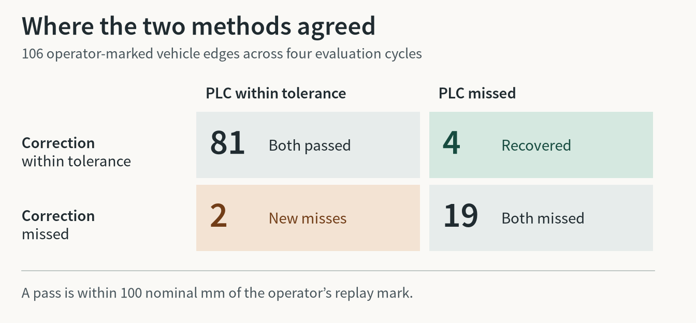

# Testing vehicle tracking through mist in an automated car wash

Laser scanners at the entrance and exit of the wash bay track the front and rear of each vehicle. On cold days, the controller could mistake a reflection from mist for the front of the car and report that its position had jumped. The operator could still see the car’s outline in the replay. Tightening the filter sometimes made the controller lose the vehicle altogether.

I built an offline test around what the operator could see in those recordings. We compared two models with the controller on the same vehicle edges. The better model put two more edges within tolerance overall. Every reading it changed was on a scan the operator judged clear.

## From recordings to a benchmark

I decoded recordings from 12 washes at four sites and built a browser review tool. It took the operator straight to moments during loading, the underbody wash and unloading, the three phases when the controller measures the vehicle. The operator could play the surrounding scans, tap the furthest solid return at either end of the car, or mark an edge as absent or uncertain. They recorded mist separately.

Counting front and rear separately, the operator marked 438 visible edges. I split the recordings by whole wash so adjacent frames stayed together. Eight washes supplied 332 marks for development and four supplied 106 for evaluation. Two evaluation washes came from a site outside the development set. A reading passed if it was within 100 mm of the operator’s mark on the replay scale. A missing reading on a visible edge counted as a miss.

## Two ways to find the vehicle edge

My first model chose which group of neighbouring laser returns belonged to the edge of the car. I trained a shallow decision tree on Azure Databricks using the distance and strength of the returns, nearby beams and the previous scan. It passed on just half the evaluation marks. The existing programmable logic controller (PLC) was usually the better starting point.

For the second trial I kept the PLC reading by default. A small tree could switch the rear edge to a different group during the underbody wash. A movement rule could adjust the front edge during unloading. I selected those changes by testing across whole washes and sites in the development data, then froze the method and scored it on the same four evaluation washes. I ran this trial locally and tracked it in Azure-hosted MLflow.

## Did it improve?

| Method | Within tolerance overall | Within tolerance in confirmed mist |
|---|---:|---:|
| Existing PLC | 83 / 106 (78.3%) | 5 / 6 |
| First decision tree | 53 / 106 (50.0%) | 6 / 6 |
| Selective correction | 85 / 106 (80.2%) | 5 / 6 |

The correction recovered four misses and moved two previously good readings outside tolerance, a net gain of **1.9 percentage points**. In a second review with both predictions hidden, the operator judged all seven changed positions clear. Of the 106 marks, 19 were confirmed clear, six had confirmed mist and 81 had unknown mist status. The correction and the PLC passed on the same five mist marks. The first tree picked up the sixth, but all six came from just two washes. [Historical results](evidence/historical-benchmark.json)



**I recommended keeping the existing controller.** The PLC and the correction each had 13 errors over 500 mm on the replay scale. The operator’s marks were too far apart to establish whether the correction prevented sudden jumps. To test that, I’d use fresh mist-affected washes and mark the same edge just before, during and after a jump. Before a live trial, I would also check the distances against an independent measurement in the bay and time the correction on the PLC.

## What ran on Azure Databricks

For the first trial I stored 1,232 observations and 21,457 candidate beam groups in two Unity Catalog managed Delta tables. The job read version 0 of both tables, checked their contents against the staged inputs and logged the model, input hashes and scores in MLflow. The first run failed while reading package metadata after scoring. I fixed the lookup and the rerun reproduced all 99 metric values. [Databricks run extract](evidence/databricks-pilot.json)

## Run the scoring example

The public example uses 12 invented observations. Run it from the repository root with Python 3.10 or later.

```sh
python3 example/score.py example/replay.csv
python3 -m unittest discover -s example
python3 -m unittest discover -s evidence
```

The example reports four PLC passes and five model passes on nine visible edges. The notebook scores the same data in Spark SQL and logs the results in MLflow. In a local test it reproduced the original scores after the Delta table changed because it still read version 0. [Scoring rules](example/README.md) · [Databricks notebook](databricks/replay.py) · [Version-pinning test](evidence/synthetic-delta-check.json)
